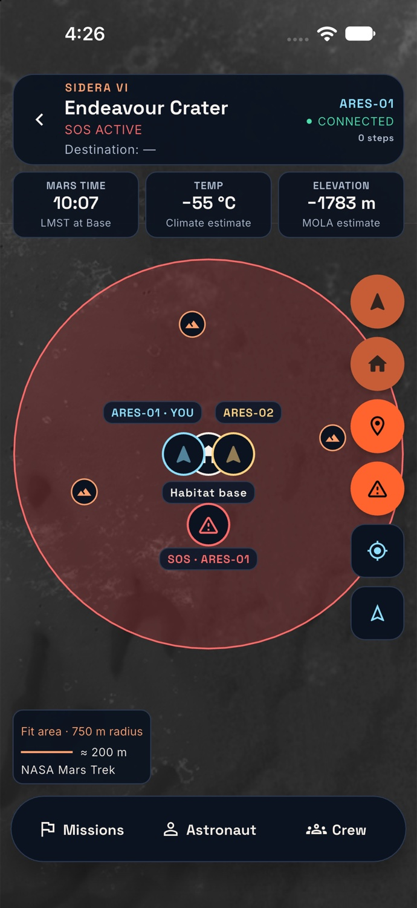
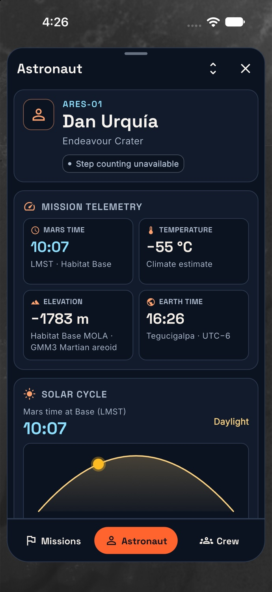
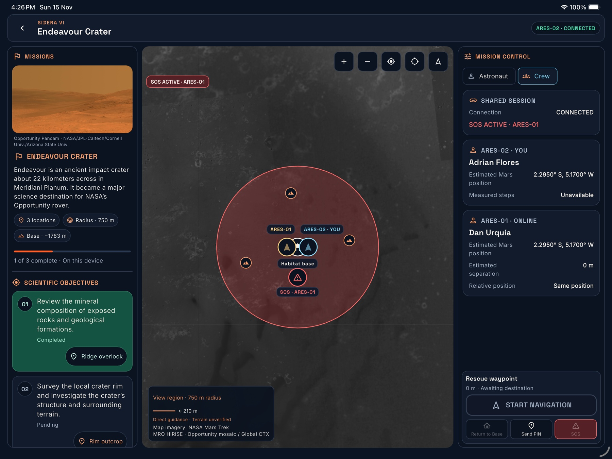
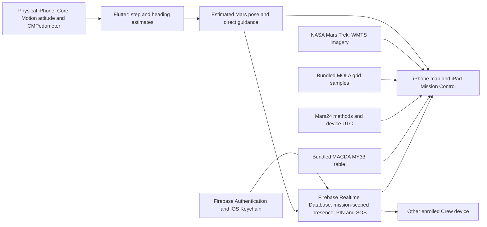

# SIDERA VI
## Martian Explorer

*Exploring Mars, one step at a time.*


SIDERA VI turns a walk on Earth into an estimated exploration of Mars. Choose one of five regions, navigate across published Mars imagery, investigate a scientific waypoint, and coordinate with another astronaut. The Urquía and Flores families built this educational prototype for the **2026 NASA Space Apps Challenge**, in response to **Interplanetary Survival Guide: Martian Map**.

**[Official website](https://sideravi.study)** · [NASA Space Apps 2026](https://www.spaceappschallenge.org/2026/) · [Challenge brief](https://www.spaceappschallenge.org/2026/challenges/interplanetary-survival-guide-martian-map/) · [Source code](https://github.com/DanUrquia/SIDERAVI/tree/main/lib) · [Scientific methods and data](docs/scientific_missions.md)

## Contents

- [The story behind SIDERA VI](#the-story-behind-sidera-vi)
- [Explore the app](#explore-the-app)
- [Five Martian missions](#five-martian-missions)
- [Navigation and mission control](#navigation-and-mission-control)
- [Crew collaboration](#crew-collaboration)
- [Scientific foundations and data sources](#scientific-foundations-and-data-sources)
- [Scientific accuracy and educational scope](#scientific-accuracy-and-educational-scope)
- [Architecture and technology](#architecture-and-technology)
- [Validation](#validation)
- [Run and test locally](#run-and-test-locally)
- [Team and credits](#team-and-credits)

## The story behind SIDERA VI

> What if our children could explore Mars, discover its wonders, and find their way safely back to base?

That question brought the Urquía and Flores families together. A map lets students see Mars. A mission asks them to decide where to go, what evidence to look for, and when to return. SIDERA VI brings those choices into one hands-on activity. Students can walk with a phone, compare their estimated position with imagery from Mars orbit, and share a waypoint with a teammate.

Dan and Adrián, both 12-year-old Mission Test Pilots, tried the missions hands-on and gave feedback on the exploration experience. Their perspective helped the team make planetary science, navigation and teamwork approachable for young learners. [Project story](https://sideravi.study/#story)

## Explore the app

1. Enter as ARES‑01 or ARES‑02 using the local astronaut PIN. The cold launch shows the official wordmark over a real Viking Orbiter 1 Mars mosaic for about **four seconds**, including the transition into the PIN screen. The footer reads “Made with Super Intelligence.” Reduce Motion removes the fade.
2. Open a mission briefing and choose a scientific objective. Start the mission to enter the map at Habitat Base or resume a saved expedition.
3. Select a landmark or tap the map, then choose **Start Navigation** for direct guidance. On supported physical hardware, walking updates the estimated Mars position even before a destination is chosen.
4. Open **Astronaut** to check the sun, terrain and exploration status. With two enrolled devices in the same mission, open **Crew** to see each astronaut’s estimated location and share a destination.

| iPhone map | Astronaut dashboard |
| :---: | :---: |
|  |  |



*Screenshots captured in the running iOS and iPadOS simulator builds. The iPhone shows the full-screen map during a test SOS and the Astronaut bottom sheet. The iPad puts the scrollable objectives and Mission Control beside a large map, with tablet-sized camera and route controls.* [Layout and controls](docs/mobile_navigation.md)

## Five Martian missions

Each expedition has a credited rover or orbital briefing image, a simulated Habitat Base, an operational radius measured from that base and **three scientific objectives**. Each objective links to its own educational waypoint. Use the location button to select the waypoint and tap the objective card to mark progress on that device. The briefing and checklist use the same objectives. [Objective-to-waypoint assignments and image credits](docs/scientific_missions.md#missions-sheet-images-and-waypoints)

| Mission | Scientific focus | Operational radius | Briefing imagery |
| --- | --- | ---: | --- |
| Endeavour Crater | Compare minerals and rock formations along the western rim and look for evidence of past habitability | 750 m | Opportunity Pancam |
| Gale Crater | Examine sandstone cross-bedding, evidence of past water and the strata of Mount Sharp | 650 m | Curiosity Mastcam |
| Columbia Hills | Compare Spirit’s rock classes and investigate evidence of ancient water activity | 850 m | Spirit Pancam |
| Valles Marineris | Read canyon terrain and look for clues to erosion, collapse and past climate | 1,000 m | Viking Orbiter 1 |
| Jezero Crater | Investigate an ancient delta, possible former channels and potential biosignatures alongside nonbiological explanations | 500 m | Perseverance Mastcam-Z |

## Navigation and mission control

### Walking and map guidance

On a supported iPhone, Core Motion provides cumulative step counts and relative device attitude to Flutter through native platform channels. Pedestrian dead reckoning (PDR) resolves each accepted batch of steps into estimated distance and direction. It uses a configurable stride with a 0.70 m starting value and can use eligible native distance estimates. The app projects the estimated displacement onto the Mars 2000 sphere from the mission’s Habitat Base. A usable orientation reference starts automatically, and **Calibrate Walking Direction** can set a new reference. Positions save by astronaut and mission, and a confirmed **Start New Expedition** resets the estimate to Habitat Base. [Tracking methods and walking procedure](docs/real_navigation_validation.md)

Select a map point, scientific landmark or online crewmate, then choose **Start Navigation** to display a direct line and remaining spherical distance. **Return to Base** selects the habitat for guidance when the return action is available. **Recenter** preserves the zoom, **Follow** keeps the astronaut in view, and **Fit Area** frames the mission radius. **North-Up** holds the terrain steady while the astronaut marker turns. **Heading-Up** rotates the map with the calibrated direction and keeps labels upright. [Camera and map behavior](docs/mobile_navigation.md#phone-camera)

### Astronaut dashboard

- The dashboard identifies the astronaut and mission. **Mission Telemetry** groups Mars local mean solar time, Tegucigalpa time (UTC−6), the MACDA air-temperature estimate and Habitat Base elevation.
- **Solar Cycle** shows estimated sunrise, sunset, daylight duration and solar elevation, with a compact version on the phone map.
- **Exploration Status** shows estimated position, distance traveled, distance to base, total measured steps and applied steps.
- **Mission Controls** offers Pause, Resume and a confirmed expedition reset on iOS. **Mars Topography** gives the highest sampled grid-cell elevation inside the operational boundary.
- **Device Sensors** shows heading and step availability, calibration, stride adjustment, Sensor Test and Movement Log. The iOS Walking Detection Lab is a separate diagnostic. [Mission Control and device diagnostics](docs/mobile_navigation.md#bottom-sheets)

## Crew collaboration

### Presence

An enrolled iOS or iPadOS device connects automatically when it opens its mission. Each astronaut has an independent device identity and publishes their estimated Mars pose and online status. Fresh updates show the teammate on the map and provide estimated separation. The client reconnects after a transient interruption. Mission and session boundaries keep separate expeditions isolated. [Connection and enrollment model](docs/live_astronaut_tracking.md)

### Destination PIN

**Send PIN** shares the **selected destination**, such as a scientific waypoint. Select a destination first, then send it to the current Crew session. The marker identifies its sender by ARES ID. Each viewer sees their own PIN in cyan and the teammate’s PIN in amber. The shared marker expires after 60 seconds. A teammate can tap it to select the destination and decide when to start guidance. [PIN behavior](docs/crew_signals.md#destination-pin)

### SOS rescue

The sender confirms **Send SOS** to share their estimated Mars position at that moment. The teammate receives a red distress modal and a rescue waypoint, and both maps show the red mission boundary. Rescue guidance takes priority while the alert is active. The sender can cancel, or the teammate can resolve the alert by crossing into the five-meter radius from outside with accepted estimated movement. Firebase synchronizes the incident state. **SOS is an educational in-app alert for the crew. It does not contact emergency services.** [SOS lifecycle and arrival checks](docs/crew_signals.md#crew-rescue)

## Scientific Foundations and Data Sources

| Source | Role in SIDERA VI |
| --- | --- |
| **NASA Mars Trek** | Georeferenced Mars imagery arrives through HTTPS WMTS tiles. The maps use global MRO Context Camera (CTX) coverage, regional CTX mosaics at Gale and Jezero, and HiRISE mosaics at Endeavour and Columbia Hills. Published coverage and raster resolution determine the useful map detail. [Mars Trek](https://trek.nasa.gov/mars/) · [Integration and WMTS layers](docs/mars_trek_integration.md) |
| **NASA MOLA MEGDR** | The Mars Orbiter Laser Altimeter flew on Mars Global Surveyor. Its 128-pixels-per-degree grid supplies Habitat Base estimates and the highest sampled cell within each radius, in meters relative to the GMM3 Martian areoid. All five base cells are interpolated. The grid spacing is about 463 m north to south, which limits the terrain detail those values can express. [PDS MOLA grid](https://pds-geosciences.wustl.edu/missions/mgs/megdr.html) · [Sampling method](docs/scientific_missions.md#mola-elevations-and-sampling) |
| **NASA GISS Mars24** | The app uses device UTC and Habitat Base longitude to compute Mars Sol Date and Local Mean Solar Time. Mars24 solar longitude, declination and the equation of time feed the app’s geometric sunrise, sunset, sun elevation and daylight-duration calculations. [Mars24 algorithm](https://www.giss.nasa.gov/tools/mars24/help/algorithm.html) · [Solar methods](docs/scientific_missions.md#solar-cycle) |
| **MACDA v2.0** | This external Mars atmospheric reanalysis provides historical Mars Year 33 near-surface air temperatures. The team generated regional tables from the archive and bundled them for offline seasonal and local-time interpolation. **MRO’s Mars Climate Sounder (MCS)** contributes observations through the reanalysis, while the app reads its derived table. [CEDA dataset and citation](https://doi.org/10.5285/cd037a9ea387438fabf4d674dbe53088) · [Preparation and interpolation](docs/scientific_missions.md#near-surface-climate-estimates) |
| **NASA Planetary Data System** | The archive provides planetary data and instrument metadata, including MOLA through its Geosciences Node. The Curiosity REMS and Perseverance MEDA archives provide context for rover weather observations. Displayed temperatures come from the MACDA table. [NASA PDS](https://pds.nasa.gov/) · [Temperature provenance and observational context](docs/scientific_missions.md#near-surface-climate-estimates) |

The briefings include published images from Opportunity, Curiosity, Spirit, Viking and Perseverance. The original image credits and regional geography references are listed for each location. [Mission source catalog](docs/mars_mission_sources.md)

## Scientific Accuracy and Educational Scope

- **Imagery and elevations.** Published orbital products depict Mars at their own registration and resolution. Habitat and boundary maxima are sampled from a gridded elevation product. Narrow ridges, cliff faces and local elevation changes may fall below the grid’s resolution.
- **Solar and climate estimates.** Sunrise and sunset use an unobstructed geometric horizon. They omit local terrain, atmospheric refraction and the apparent solar limb. The temperature is an interpolated historical reference from one modeled Mars year. It cannot predict the current sol’s weather or resolve crater microclimates.
- **Position and walking.** The map represents estimated displacement from a local heading and measured Earth steps. This is educational PDR, with drift from heading, stride and delayed sensor batches. It does not locate anyone on Mars or establish absolute walking accuracy. Simulators can render the map and synchronize Crew while reporting no physical steps.
- **Guidance and rescue.** Direct guidance is a straight geographic line. It does not verify safe terrain. The mission radius is a scenario parameter, and SOS alerts stay within the app.
- **Offline operation.** Briefings, science tables, objective progress and estimated movement on supported hardware work locally. Uncached Mars Trek tiles and shared Crew activity require an internet connection. [Scientific methodology](docs/scientific_missions.md) · [Sensor evidence](docs/real_navigation_validation.md)

## Architecture and technology



The Dart client authenticates each device and astronaut slot with an anonymous Firebase identity and saves the renewable credential in the **iOS Keychain**. The local astronaut PIN selects a roster entry. Firebase authorization requires a separate operator assignment. The Realtime Database is a JSON tree, with each mission and session holding membership, presence, destination PINs and the shared SOS record. Security Rules scope reads to authorized session members and restrict writes to the assigned slot or valid SOS transitions. REST handles reads and writes, while server-sent events (SSE) stream changes. Crew receives estimated Mars coordinates and status. Earth fixes and diagnostic traces stay on the device unless the operator explicitly exports them. [Firebase setup and data model](docs/live_astronaut_tracking.md) · [Rules](firebase/database.rules.json) · [PIN and SOS schema](docs/crew_signals.md#firebase-schema-and-authorization)

| Technology | Verified configuration and role |
| --- | --- |
| Flutter and Dart | Flutter **3.35.4**, Dart **3.9.2** for the application, UI, map rendering, scientific calculations and tests |
| Swift and Xcode | Runner uses Swift **5 language mode**. Final native tests ran with **Xcode 27.2** and its Swift **6.4.2** compiler. |
| iOS and iPadOS | Runner deployment target **17.6**. iPhone uses portrait and iPad supports both landscape orientations. |
| Apple Core Motion and native platform channels | Attitude, `CMPedometer` step and distance readings, and messages between Swift and Dart. Core Location supports the separate foreground Sensor Test. |
| Firebase Auth, Realtime Database and Security Rules | Enrolled anonymous device identities, session-scoped JSON state and constrained writes over REST and SSE |
| Python | Offline preparation of the bundled MACDA table from the archive |
| Git and GitHub | Source history, review documentation and reproducible commands |

## Validation

| Evidence | Observed result |
| --- | --- |
| Physical iPhone 16, Phase 6B.3 | A Jezero out-and-back showed **43 detected and applied steps**, **35.6 m estimated travel** and about **7 m remaining to base**. The distance is the app estimate from that walk. [Field notes](docs/real_navigation_validation.md#phase-6b3-iphone-result) |
| Two physical iPhones, Phase 6E | iPhone 16 and iPhone 14 Plus both joined Endeavour at Habitat Base, with 0 m separation. Firebase later recorded **10.54 m** estimated displacement for moving ARES‑01 and **0 m** change for stationary ARES‑02. This observation covered one direction of physical movement. [Field notes](docs/real_navigation_validation.md#phase-6e-iphone-field-check) |
| Physical iPhone and iPhone simulator | Recorded a selected destination distinct from the sender’s pose, showed the teammate PIN and verified the SOS receipt, waypoint and sender cancellation in an isolated session. A completed rescue by physical walking remains a field check. [PIN and SOS trial](docs/crew_signals.md#phase-6g1-verification) |
| iPhone and iPad simulators | Both joined the isolated Endeavour session as separate astronauts and saw the other online. Landscape layout, objectives and telemetry were exercised on the iPad simulator. [iPad validation notes](docs/mobile_navigation.md#final-simulator-verification) |
| Final automated checks | `flutter analyze` passed, **127 Flutter tests** and **8 native XCTest cases** passed, and the Firebase Auth and Realtime Database emulator suite passed. Coverage includes launch timing and accessibility, geometry, science reference values, mission and sensor behavior, authorization, mission isolation, PIN and SOS. |

The final iPad dashboard was visually exercised in a simulator. Earlier iPad sensor feasibility work used different builds on physical tablets and is recorded separately. [Historical iPad sensor tests](docs/sensor_feasibility.md)

## Run and test locally

Use a Mac with Xcode and an iOS simulator runtime installed. The final build was checked with Flutter 3.35.4, Dart 3.9.2 and Xcode 27.2. Start an iPhone or iPad simulator in Xcode’s device tools, then run the following from this repository.

```sh
git clone https://github.com/DanUrquia/SIDERAVI.git
cd SIDERAVI
flutter pub get
flutter devices
flutter run -d "SIMULATOR_ID"
```

Replace `SIMULATOR_ID` with the identifier returned by `flutter devices`. Choose ARES‑01 or ARES‑02 using the [bundled local demo PIN definitions](lib/auth/prototype_auth.dart). You can explore the briefings, map, objectives and scientific telemetry in this setup. Firebase Crew requires an authorized build configuration and an enrolled identity per device and slot. This repository provides the local experience and emulator tests for reviewers. The [official website](https://sideravi.study) is the public project overview.

For a physical Apple device, open `ios/Runner.xcworkspace`, select a development signing team you control and use a trusted, developer-enabled device. Use a local bundle identifier if your team requires it. [Development and Crew setup](docs/live_astronaut_tracking.md)

```sh
flutter analyze
flutter test

flutter build ios --debug --simulator --config-only
xcodebuild -workspace ios/Runner.xcworkspace -scheme Runner -configuration Debug \
  -destination 'platform=iOS Simulator,id=SIMULATOR_ID' \
  -parallel-testing-enabled NO -only-testing:RunnerTests test

npx --yes firebase-tools emulators:exec --only auth,database \
  --project demo-sideravi 'node firebase/test-rules.mjs'
```

The Firebase emulator command uses a local demo project and requires Node.js and Java for the emulator runtime. [Firebase Emulator Suite](https://firebase.google.com/docs/emulator-suite/install_and_configure)

## Team and credits

**SIDERA VI** is a collaboration between the **Urquía and Flores families**. The registered team includes Dan Urquía, Edgardo Flores, Alejandra Nazar, Adrián Flores, Dan Urquía Jiménez and Keren Ibel Jiménez. Dan Urquía Jiménez and Adrián Flores were the Mission Test Pilots. [NASA Space Apps team entry](https://www.spaceappschallenge.org/2026/find-a-team/sidera-vi/?tab=project)

Thanks to the NASA Space Apps community, NASA and JPL’s Mars Trek and rover teams, NASA GISS, the NASA Planetary Data System and the MOLA science team. MACDA v2.0 is credited to A. Valeanu, K. Rajendran, L. Montabone and P. L. Read and is distributed by NERC EDS CEDA. The team supplied the SIDERA VI branding. Inter and Space Grotesk are bundled with their SIL Open Font License texts. OpenAI Codex assisted with implementation, debugging and documentation. [MACDA citation](https://doi.org/10.5285/cd037a9ea387438fabf4d674dbe53088) · [Font licenses](assets/fonts/)

SIDERA VI is an independent educational project for NASA Space Apps. NASA does not endorse or certify it. [Official project website](https://sideravi.study)
